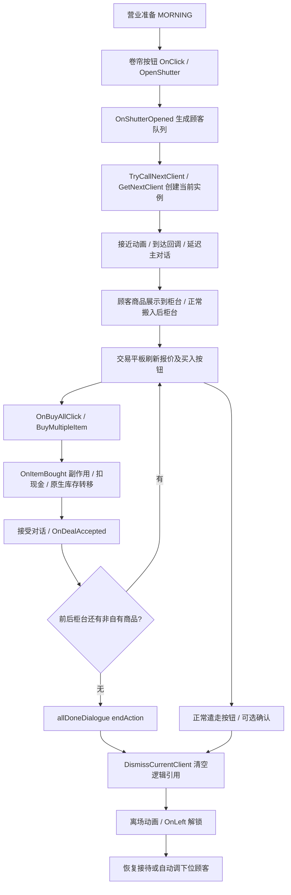

# PawnPilot M2-A：普通交易路径与只读探针

日期：2026-10-31。整体 **PASS（本报告限定的普通买入调查及最小只读探针范围）**。本轮取得完整实机授权，完成一次正常 UI 普通购买、真实诊断采样及清理。M2-A 不等于交易 action 已可安全开放：MCP 仍只有原 M1 的 close_menu；完整库存、数值报价、顶层 UI 和交易执行器尚未实现。

首条路线：**玩家按当前报价买入普通 SELL 顾客的非自有商品集合**，NPC 的 `StoreClient.ClientIntent.SELL=2`。实机为学徒、普通难度、跳过序章、第 1 天拾荒客，使用普通“购买8物品”，没有接受批发或讨价还价。后续 M2-D 首次开放仍建议限制可买集合恰好一件、非堆叠且有确定库存空间；这是待实现约束，本轮未单独验证单件拖拽交易。

## 1. 基线与证据边界

| 项目 | 本轮重新核对结果 |
|---|---|
| 仓库位置 | `D:\c\aaaprojects\PawnPilot\PawnPilot`，双层目录保留 |
| 初始 HEAD / 工作区 | `481cfa9bdda33cdf6c2c7ae85830bc377de9883d`；干净 |
| 游戏位置 | `E:\SteamLibrary\steamapps\common\Probably Stolen` |
| Steam manifest | `appmanifest_4348910.acf`，build / TargetBuildID 均 `26337366` |
| UnityPlayer 文件版本 | `2021.3.45.8976527` / `2021.3.45f2 (88f88f591b2e)` |
| 主程序集 SHA-256 | `6398d44aa1675e1f02b63bc668868f970e0f5d3ae5a50f2aced8d06ca084e3b5` |
| 应用 / 保存版本 | 本轮 PAWNPILOT_INIT 重新确认 `0.46D / VERSION 100-Rev6`，主菜单也显示 VERSION 100-REV6；ModEntry 版本门禁保持不变 |
| 基线回归 | 43 Python + 39 managed，通过；沙箱首跑 Python 为 34 通过、9 error，含 8 个 stdio 命名管道 WinError 5；宿主全量重跑 43/43 通过 |
| 最终验证 | 43 Python + 49 managed = **92 通过、0 失败**；新增 10 个 managed 检查；诊断及默认构建结果见第 7 节 |

证据等级：**IL** = 本机当前 DLL 经 Mono.Cecil 只读反汇编；**fixture** = managed/Python 自动化输入；**live** = 本轮游戏截图、Player.log 与既有 broker 只读状态（第 8 节）。没有从脚本直接调用被调查的业务方法，游戏正常 UI 自行执行它们；调用链方法体证据来自 IL，而非运行时逐方法追踪。下述方法全部位于 `Assembly-CSharp.dll`；方法 token 用 MethodDef RID 简写，如 `0x267d` 对应 `0x0600267d`，IL 偏移均为方法内偏移，随版本变化。

读取了 README、M0/M1 报告及证据、Probe/Protocol/ModEntry、broker/journal/MCP 源码。保留 schema=1、四个 MCP 工具、18765 回环端口、主动 UnityWebRequest 协程、单写/去重/unknown 门禁；没有新增业务 action。官方 Mod 文档使用仓库既有本地快照 `d0538eacf763675d8e74c982d80c2d915f721a25`，以实际 DLL 为准；STS2 仅复核已有 `ActionExecutionGate` 的跨等待单写设计，没有复制其代码或通信架构。

四个非 Astra Luna 子代理并行只读调查，主 Agent 逐段复核成交方法、UI 委托、字段读写及离场回调；测试文件单独分配所有权。复核纠正了两个重要误读：`OnOfferAcceptClick` 的特殊业务 `CompleteBusiness` 不是普通买入完成信号；普通 all-done 对话的 endAction **确实可以自动遣走顾客**。

## 2. 路线比较与选择

| 候选 | 实际复杂度及选择 |
|---|---|
| 玩家买入、顾客 SELL | `OnBuyAllClick` 有资金/业务状态门禁，汇入 `BuyMultipleItem → PlayerStore.BuyItem`；选择此路线。实机正常购买集合 8 项，后续自动动作先限制集合恰好一件。按钮本质是“买入集合”，不是自造的单物品 API |
| 玩家卖出、顾客 BUY | 除资金外还经 `TryReinspectBeforeSale`（会检查隐藏特征并刷新 UI）、兴趣/种类限制、预算不足确认，结算前检查违禁品等安保状态；暂缓 |
| 讨价还价/易货/信息商/订单 | 有随机结果、临时价格特征、服务费/销毁/分支对话；不作为首条路线 |

没有假设买入天然简单：比较依据是 `BuildSelling → OnBuyAllClick` 与 `BuildBuying → OnSellAllClick` 的实际委托和各自结算体。注意 UI 内部 BuildSelling 指顾客出售，不能按玩家视角机械翻译方法名。

## 3. 完整基础路径（IL 调用链 + 一次正常 UI 实机对照）



| 节点 | 真实入口、证据锚点 | 前置、完成/异常判据、副作用与时序 |
|---|---|---|
| 开始营业 | `void StoreShutterButton.OnClick()` `0x1f7f`；`OpenShutter()` `0x1f81` | OnClick 检查卷帘锁、逮捕/枪战，MORNING 分支调用 `CanStartDay`；OpenShutter 调用 `PlayerStore.OnShutterOpened` 和 `PlayerStore.OpenShutter`、改变门/前柜显示、安排延迟解锁。不能跳过外层门禁直接写 storeState；拒绝时没有营业转换 |
| 生成与叫号 | `PlayerStore.OnShutterOpened()` `0x1762`，`TryCallNextClient()` `0x1766`，`GetNextClient()` `0x1764` | GenerateClient、未来队列处理；CanNextClient 要求队列非空、无当前实例、无战斗/逮捕。GetNextClient 取队首、删除队首、设 sprite、记录到访与统计、清空议价目标，再创建实例。未来队列属于隐藏信息，不导出 |
| 到达 | `StoreUIManager.QueueClientArriveAnimation()` `0x2824`；`StoreClientMono.StartApprochingStore()`；`StoreUIManager.OnNextClientArrived()` `0x282c` | 先 `isClientArrived=false`、ClientFlagUp 和显示角色，再启动 DOTween 路径。到达后运行 OnArrival/犯罪到访/柜台刷新，约 0.25 秒后开始主对话。逻辑实例存在不等于已经到达；本轮 live 确认拾荒客先 pending 后 arrived，再展示商品/平板 |
| 对话与准备 | `StoreClient.StartMainDialogue()` `0x1c0b` → `DialogUIManager.StartDialogue(Dialogue,bool)` `0x24ac` | 对话 start/end/choice actions 可产生业务副作用；`OnAdvancePressed()` `0x24a6` 会先跳过打字，再按 pending 状态推进；不是纯“下一句”。选择入口 `DialogChoiceBubble.OnDialogChoiceClick()` `0x1c8a` → `SelectChoice(int)` `0x24bb`，先检查交互状态/合法选项，约 0.5 秒后继续 |
| 柜台/交易 UI | `NegociationUIManager.ResolveMode(StoreClient)` `0x2650`；`Rebuild` `0x2665`；`BuildSelling(StoreClient,bool)` `0x266b` | SELL→mode 2，列举后柜非自有物品；`BuildSelling IL_02d3` 的 `ldftn` 直接绑定 `OnBuyAllClick`。Update 每 0.2 秒刷新，LateUpdate 处理 refreshQueued；旧标签可能滞后一帧，不能把看见按钮等同于业务已稳定 |
| 确认购买 | `void NegociationUIManager.OnBuyAllClick()` `0x266c` | 当前顾客、非 trade-locked、非已完成、非 isRegularSellDisable；收集非自有后柜物品，受 isMultiBuyDisabled 限制；空集合或总报价超过 playerCash 返回。调用 BuyMultipleItem 前已调用教程 hook，不能视所有早退都绝无副作用 |
| 经济结算 | `void BuyMultipleItem(List<GameItem>)` `0x267d` → `void PlayerStore.BuyItem(GameItem)` `0x17bb` | 集合倒序同步处理；`BuyItem IL_0014` 计算报价，`001f` 调 OnItemBought，`002d` 写扣款，`005e` 店内 TryAcceptAll，`0063 pop` 丢弃剩余量。经济副作用已经发生，异常/容量不足不能重试 |
| 接受及完成 | `PlayAcceptDealDialogueOnce(StoreClient)` `0x2680`；`StoreClient.OnDealAccepted(Dialogue)` `0x1be3` | 接受对话 startAction 绑定 OnDealAccepted；未开始接受对话时传 null 直接进入后续。SELL 的 `IsClientBusinessDone` `0x1c23` 要求前/后柜均无非自有商品；不是单看 isBusinessComplete，更不是 UI 关闭 |
| 自动离场 | `StoreClient.AddBasicDialog()` `0x1be2`；嵌套 `<AddBasicDialog>b__136_0()` `0x56d3` | allDoneDialogue 的 endAction 在 IL_0008 调 `DismissCurrentClient(false,true,true)`；等待对话真正结束。部分顾客自定义对话可以改变流程，首轮必须确认采用普通路径 |
| 拒绝/提前结束 | `StoreDismissButton.OnClick()` `0x1f1c` → `PlayerStore.TryPlayerDismissCurrentClient(bool)` | 要求 lockNextBellFlag 解除且顾客可遣走；UI 可能要求按住约 0.4 秒及确认。拒绝当前顾客并非“关闭平板”，可能清除未购买商品、改变业务及顾客回调；确认 No 只取消确认 |
| 引用失效/重新就绪 | `PlayerStore.DismissCurrentClient(bool,bool,bool)` `0x1778` → `OnClientStartLeaving(bool)` → `StoreClientMono.OnLeft()` `0x280e` | Dismiss 复制 lastVisitedClient，运行 OnDismiss，`IL_006b` 清空 currentClientInstance、清理未购货/临时特征/议价目标并启动离场。OnLeft 才隐藏角色/解除锁；自动叫号时再等待约 0.5 秒。逻辑引用失效早于画面消失 |

入店展示与柜台搬运的具体入口补充见第 4 节。本表是方法链的静态解释，第 8 节逐项给出实际可观察时序；不宣称所有新开局、角色、教程或特殊 NPC 都必经这些节点。

本轮顾客的具体生成和上货链已核对：`StoreClientManager.GenerateClient()` `0x1c2e` 在 `IL_003d–0043` 先调用 `HandleSkipClient()`；后者 `0x1c44` 检查 skipIntro 与 dayCounter==1，非特殊开局在 `IL_0050–0055` 调 `StoreClientList.CreateScavGeneral()` 并 AddClient。该工厂 `0x19b8` 设置 scavGeneral / name_scavenger / SELL，提供 15–25% 的可选批发优惠，并于 `IL_00f3–00fe` 把最后一句主对话的 endAction 绑定到 `<CreateScavGeneral>b__0()` `0x536e`。该回调先 `AddScavGeneralStock()`，再 `OnIntroduced()`。后者在有批发选项时打开平板，但不强制走批发成交。

叫号按钮是 `StoreBell.OnClick()` `0x1ee9` → `RingBell()` `0x1ef0`：先运行教程 BellRing/CloseBarterTutorial，再检查 lockNextBellFlag；OPEN 且无当前顾客时 `IL_007b` 调 TryCallNextClient。**有顾客时它可能走 TryPlayerDismissCurrentClient(true)**，不是可随时重试的无害叫号。`ShouldRequireHold()` `0x1ee8` 在非 instantCallNextCustomer 且有顾客时要求 hold。后续 receive 动作必须先绑定“无当前顾客”的前置状态并复核。

`AddScavGeneralStock()` `0x19b9` 随机投放商品，不固定为 8 件；普通电子元件、厕纸、香烟、医疗用品、绷带对应工厂分支均存在。食品来自 packedFoodTable，本轮不通过隐藏表内容补充玩家观察。`AddDirectSellingItemToTable(string,bool,bool,bool,int)` `0x17b0` → `TryAddDirectSellingItemToTable(string,...)` `0x17b1` 创建物品 → `TryAddDirectSellingItemToTable(GameItem,...)` `0x17b3`，设置归属、检查声望限制，`IL_00cd` 经 TryAcceptAllOrDestroy 放进前柜；前柜满可能跳过/销毁未放置商品。该供应路径参数 false/false/false/0 表示非自有、未请求赃物初始化、正常 perk 处理。只读探针不调用这些创建方法。

离场还有 fallback：`CreateDefaultAllDoneDialog()` `0x197b` 的对话结束回调调用 `DialogUIManager.CurrentClientLeave(1f)` `0x24c5` 再延迟 Dismiss；不能把所有顾客离场时延都写成一个固定常量。

### 买入的完整副作用和后置验证

`PlayerStore.OnItemBought(GameItem,int)` `0x17bc`：清 ALREADY_CONFRONTED_TAG；调用 **NPC 视角的** `StoreClient.OnItemSold`（`IL_0023`，执行自定义委托，启用预算时增加 clientBudget）；更新声望 `0033`、买价追踪 `0046`、统计 `004e`；特定设备增加统计/analytics；`0090 SetItemOwned(true)`，清除事件/临时购买特征。随后 BuyItem 扣现金并移动。这不是一个可回滚的原子事务。

成功证据应同时包含：同一 world/customer、确认时的可见报价、现金正确减少、原后柜项目消失/数量减少、玩家目标库存出现对应物品/数量、所有权状态一致，然后等待对话/动画稳定。`GraphUtils.TryAcceptAll` 返回**未转移数量**；0 也可能是 null 参数早退，不能孤立作为成功。原生 BuyItem 忽略返回值，尤其应限制首轮单件非堆叠、有确定空间。不足容量或现金变化但物品未到位为 `outcome_unknown`/人工核对，不能重新点击。

未在这条结算体找到显式 SaveGame 调用；不据此声称交易没有保存副作用。顾客委托、正常自动保存和 UI 生命周期仍可能保存；实机需检查时间顺序。关闭平板、播放收银声音、对话出现或 isBusinessComplete 单独变化都不足以证明成功。

## 4. 对象、归属、移动与引用

| 对象 | 代码依据 | 后续引用/失效要求 |
|---|---|---|
| 当前顾客 | `PlayerStore.currentClientInstance : StoreClientInstance`；私有 storeClient 经 `GetClientBlueprint()` `0x1c22` 直接返回 | 实例在 GetNextClient 创建；Dismiss 清空；蓝图 identifier 不能替代本次到访身份。world + encounter generation + 当前对象身份；不导出 realName/wanted/budget 等隐藏字段 |
| 顾客可见名称 | `NegotiationTabletFrame.clientName`、`DialogUIManager.clientNameTMP` | 读取当前活动文本；潜在真实身份、未显示名称不取。名称重复不影响引用唯一性 |
| 物品定义/实例 | `Directory<T>.Create(string)` 调工厂并赋 identifier；`DirectoryMaster.Item(string,bool)` 创建实例、SetItemOwned、必要时 GetUniqueID | 没有独立只读 ItemDefinition API；绝不能为查名称调用工厂。GameItem.uniqueId 可作为辅助，但合并/拆堆/重载必须重解析，不承诺永久唯一句柄 |
| 直接容器 | `GameItem.parentInventory` `0x2f40` 纯 backing-field getter；`GameInventory.childItems`、`EmporiumEntry.invElement/frontInvinvElement/backInvinvElement` | 查询直接成员和当前 parent；嵌套库存、隐藏槽、窗体关闭需另做可见性过滤，不递归导出所有 children |
| 所有权 | `GeneralHelper.IsItemOwned(GameItem)` → `IsTag("IS_OWNED_TAG")`；`SetItemOwned` 会修改 tag | 不直接编辑 tag；可见 tooltip 某些上下文显示“不属于玩家”，不能把所有内部 tag 当可见信息 |
| 移动物品 | `int GraphUtils.TryAcceptAll(GraphNodeStorage,GameItem,int)` → slot 搜索 → `SlotMarker.TryAcceptOnce(int)` | 正常源 Expel/目标 UncheckedAccept 会触发回调、形状验证/UI 更新；堆叠走 StackItemUnchecked，拆堆 GetSplitItem，可能换对象。不能直接改 list/parent 或调用 UncheckedAccept 冒充正常移动 |
| 移动便利 API | `ModHelper.MoveItemToInventory(GameItem)` 与前后柜 wrappers | 调 TryAcceptAll 并 pop 结果；包装器没有成功证据，不能用作已验证移动动作；原生鼠标/搬运按钮链需保留其额外条件 |
| 报价/交易 | 无统一事务实体；由当前顾客、后柜物品、临时特征、UI 选中态与对话共同组成 | `currentNegociatedItem` 不等于私有 selectedItem；OnRowClick 取消选中时可能保留 currentNegociatedItem。后续动作不能仅绑定这个公共字段 |

正常准备入口已经进一步定位：`void StoreTransferButton.OnClick()` `0x1f9c` 检查 frontInvWindow.IsVisible；前柜非空时复制 children 并在 `IL_0065` 调 `TryAcceptAll(backInvinvElement,item,-1)`，`leave IL_0093` 直接进入教程回调。**该分支跳过**后面的 TransferOwnedItemBackToInv/FrontToInv；那些是无可搬前柜项目时的回收分支，不能混为总是执行。首轮应限制前柜恰好一个可见待购项目，避免搬运整个集合。

后柜接受会触发 `PlayerStore.AddedItemToWeightedArea(GameItem)` `0x17c5`，设置 currentNegociatedItem，调用物品 OnAddedToWeightedArea 和 `OnWeightedAreaChanged()` `0x17d2`；后者对非自有物品 + SELL/SELLNBUY 在 `IL_0069–0080` 进入 `PlacedItemForBuying(GameItem)`，更新平板/可能启动对话。`GameGridInventory.UncheckedAccept(GameItem)` `0x2d9d` 的验证/加权区更新也经过这些业务回调。看似对应的 `AddClientSellingItemToTable()` 实为只有 ret 的空桩，不能作为动作入口。

另一条正常路线为 `ItemQuickTransferHandler.OnEventPress/OnEventRelease(ISet<KeyCode>)`：按下/抬起重新射线命中同一物品，检查 MayRemove，前柜非自有项目转后柜；拖拽 `ItemMouseDragHandler.StartDrag/EndDrag` 检查可移除性、目标 slot，普通格子调用 `SlotMarker.TryAcceptOnce(-1)`。其上下文包含输入/假物品/旋转等状态，不能只调用私有 EndDrag。M2-D 首选明确的 StoreTransferButton 正常入口，完整拖拽协议推迟。

## 5. 公平游玩与 UI 边界

| 字段/来源 | 分类 | 本轮策略 |
|---|---|---|
| M1 现金、经营阶段 | 允许，本轮也有 live | MCP 保持原值与语义；550→254 / MORNING→OPEN |
| 当前实例存在/已到达、当前活动 UI、等待推进 | 允许作为生命周期诊断；存在/到达/UI 已 live，waiting=true 仅 IL + fixture | 输出 opaque ref / flags；存在不代表完成到达或允许交易 |
| 平板当前 header/subtitle/section、固定 footer 的可见按钮标签、确认文字 | 活动控件文本；header/section/footer 已 live，确认文字非空分支未 live | 无数值报价读取/计算；最多 4 标签，每字段最多 256 字符；不将按钮字符串自动解析成可执行经济条款 |
| 当前议价目标引用/数量 | 条件允许：顾客已到达、平板打开、无已知遮挡、目标仍在后柜 | 只导出短期 opaque ref/count，不导出定义/真值；不是私有行选中状态，暂不可供 action 使用 |
| 物品名称、类型、状态、估价/检查结果 | 必须通过实际显示的行、tooltip、已执行检查/解锁 | 映射已找到，本轮未完整实现。GetDisplayName(false) 经 name 虚属性/回退字段；没有在探针调用 |
| `unitValue/lateUnitValue/unitBaseValue/backupUnitValue`、隐藏特征/真伪、客户真实预算/身份、队列/未来事件 | 隐藏，不暴露 | 输入投影中没有这些字段；不调用对应计算/创建函数 |
| 对话 `currentDialog.plainText`/title/nextDialogue | 暂不能直接当“已显示内容” | 打字机可提前保存完整句子，未来台词还未显示；本轮仅 waiting flag，不导出原始对话对象 |
| 各 UI 的真正最高层、滚动遮罩内行、重叠遮挡 | 尚未完全确认 | 不泛扫 TMP 后代/滚动列表，不宣称 activeInHierarchy 足以证明最终屏幕可见或动作合法 |

特别排除：`GameItem.GetNegociatedValue()` `0x2ff3` 在 debugPricePanel 打开时改写 priceDebugTMP2；`GetDonationCreditValue()` `0x2ff4` 临时改 ItemFeature.isDisabled；`GeneralHelper.GetDisplayNameFromID` 缓存未命中会创建物品并写缓存。名称带 Get/Can 不构成只读保证。

已知阻挡包括 ESC、设置、通用确认、确认面板、关门确认、议价、逮捕/枪战/中枪。`NegociationUIManager.IsTradeLocked()` 只覆盖后三种战斗状态，不能替代完整动作门禁。玩家可打开多个 UI；本轮只输出 known_blocker，null 不表示安全。平板内部确认与一般 modal 分开记录，关闭确认 No 不代表拒绝顾客。

已追踪 `StoreUIManager.ResolveEscape()` `0x281e` 的优先级：RunSummary → Options → EndOfDay → ESC → WildNetwork → Overlay/ItemSelect/ItemMultiSelect 取消 → 动态窗口 → 拖拽取消 → 打开 ESC。动态 `CloseTopmostEscapeTarget()` `0x281f` 比较可移动 PixelWindow.focusStamp 与 paper/docked panel stamp，跨集合相同 stamp 时 paper 优先。这是“Escape 处理顺序”，不等于完整绘制遮挡证明。其调用的 `UIDragHandler.GetActiveDockedPanels(Transform)` `0x2355` 会 RemoveAll/Sort 注册表，**不属于只读查询**；探针没有调用它。后续需依据纯字段重建有限目标 UI 优先级并实机对照。

## 6. 后续接口草案（未实施 schema v2）

最小业务状态建议：`business_phase`、`customer_ref{world,encounter}`、`arrival_state`、`trade_kind=player_buys`、`visible_items[{item_ref,container_ref,units,label}]`、`displayed_terms{quote_ref,text,amount?}`、`dialogue_ref/visible_choices`、`blockers[]`、`legal_actions[{action,target,quote_ref}]`。所有引用都是短期能力句柄，scene/save/load/customer切换、物品离开/拆分/销毁、对话/报价变化都必须撤销或换代。

| 后续动作候选 | 原生入口 | 约束与完成条件 |
|---|---|---|
| start_business | `StoreShutterButton.OnClick()` | 准备阶段、CanStartDay、卷帘锁解除/无 modal；等待状态开门、解锁，不能仅同步返回成功 |
| receive_next_customer | `StoreBell.OnClick()` → `RingBell()` → `PlayerStore.TryCallNextClient()` | OPEN、lockNextBellFlag 解除、无当前顾客且允许接待；有顾客时同按钮可能遣走，必须拒绝过期目标；等待当前实例及 arrived；不泄露未来队列 |
| advance_dialogue | `DialogUIManager.OnAdvancePressed()` | 同一显示行、已允许跳过/推进；等待行/选择/阶段变化；可能触发 endAction 经济/离场副作用，未知不能重试 |
| choose_dialogue | 活动 `DialogChoiceBubble.OnDialogChoiceClick()` | 绑定当前 bubble/index/对话引用和实际交互状态；等待异步 continuation；不绕过 disabled predicate |
| prepare_item | `StoreTransferButton.OnClick()`；暂不开放私有拖拽方法 | 首轮前柜仅一件、前柜可见、目的可接收、无 modal；该按钮处理集合并丢弃转移剩余量，必须等待后柜成员/当前目标及报价刷新来验证 |
| accept_visible_purchase | `NegociationUIManager.OnBuyAllClick()` | 首批仅普通 SELL、可买集合恰好一件、报价/顾客/容器仍相同、可支付且有空间、真实按钮可交互；同步经济变化 + 跨帧后置验证，不能降到直接 BuyItem |
| cancel_confirmation | `NegociationUIManager.OnConfirmPanelNo()` 或对应普通确认控件 | 仅匹配当前确认来源；确认关闭；不可声称取消已经发生的购买 |
| dismiss_customer | `StoreDismissButton.OnClick()` 经正常 hold/confirmation 流程 | 可遣走、无锁；清理未购商品及业务回调；等待逻辑实例清空再等待离场结束 |

**M2-B**：先为业务快照/报价引用/目标引用设计 schema 迁移和兼容拒绝，扩展 broker `_valid_state`、journal 成功/恢复校验、Adapter StrictModel；现有 DTO extra-forbid 与 journal 对 close_menu 的专用后置规则无法直接接受扩展证据。保留原 ID、单写和未知阻塞。增加 accepted/executing/waiting/settled 证据阶段及截止策略；M1 固定约 5 秒命令 TTL 不适合默认覆盖动画和对话，需区分“开始前有效期”和“已开始结果等待”。不声称现有 journal 无改动即可承载交易。

**M2-C**：优先实现可见顾客到访引用、前/后柜可见项目、活动平板展示条款/按钮、对话显示范围和实际阻挡；增加物品数量/转移后置证据。引用与 revision 必须覆盖顾客/物品/报价变化，不能沿用 M1 只看现金/阶段/菜单的 signature。当前 diagnostic_revision 独立，不能拿它提交 M1 act。

**M2-D**：按本轮已对照的营业/叫号/到达/对话/搬运顺序实现动作门禁与跨帧等待，再实现并实测取消/遣走；补齐单件选择和容量验证后只开放单件普通买入，最后考虑多件/卖出/议价。执行器在 Unity 主线程每帧等待，期间继续心跳/结果 ACK，单写租约贯穿整个过程。成功需要现金+物品+阶段联合证据；任意崩溃、超时或同帧副作用后异常均保留 unknown，不自动重放，不以 finally 释放写锁掩盖未知结果。

## 7. 最小探针实现与测试

新增 `TradeDiagnostic.cs`（纯投影/引用/版本）及 `TradeDiagnosticReader.cs`（Unity 只读源）。复用现有 ProbeBehaviour.Update 和世界就绪判断，没有第二个 Mod、不新增配置/schema字段、不动 ActionGate。默认编译**不包含运行读取器与调用点**；显式 `M2AReadOnlyProbe=true` 才启用。没有 Harmony/反射或新 capabilities 声明。

```powershell
# 只构建项目内实验包，不安装
./scripts/build.ps1 -M2AProbe
# 默认 M1 包，诊断关闭
./scripts/build.ps1
# managed 含诊断 fixtures；不加载 Unity
$env:DOTNET_CLI_HOME = Join-Path $PWD '.dotnet'
$env:NUGET_PACKAGES = Join-Path $PWD '.nuget'
$env:DOTNET_GENERATE_ASPNET_CERTIFICATE = 'false'
dotnet run --project tests/PawnPilot.CoreTests/PawnPilot.CoreTests.csproj -c Release
.\.venv\Scripts\python.exe -m unittest discover -s tests -p 'test_*.py' -v
```

实验包位于 `artifacts/m2a/package/pawnpilot_m0`；普通包仍在 `artifacts/package/pawnpilot_m0`。运行时只向既有 ModLog 写 `PAWNPILOT_M2A_READ_ONLY`，包裹 `source=game_runtime`、frame、realtime、sample；本轮真实数据见第 8 节。测试 fixtures 不输出 game_runtime。只在诊断 revision 改变时写日志，每 Update 读取，不宣称能捕获一次函数调用内所有过渡；诊断/log 异常不会中断 M1 网络，读失败清空引用并报告 read_error。每帧固定字段/小量 footer 组件读取，未做定量性能测量。

投影对象只含明确的 string/bool/int/nullable int/string[]；从不序列化 GameItem/StoreClient/Unity 对象或 exception message。未 ready 时不调用业务 reader；场景/世界变化、顾客消失/替换、read_error 都撤销引用；采集的 UI 文本/阶段/目标变化推进独立 revision。目标离开后柜、关闭平板或已知 modal 遮挡使当前目标引用失效。数量不是唯一标识，也不表示全部库存；本轮没有采集行内价格或完整物品集合，因此价格变化不保证推进 diagnostic_revision。

新增 10 个 managed 检查涵盖：未就绪/空 world 不调用读取器；同对象跨世界换引用；顾客消失/替换重新引用；无顾客明确空；阶段/UI文本/footer/确认变化；异常清空及恢复；长度/数量上限；输出字段与类型白名单；输入数组复制。共 49 managed；Python 43 项原协议回归未修改。10 是命名检查数量，各检查可包含多个断言，**不是 Unity 集成用例数量**。

诊断构建第一次出现 `CanvasGroup` 缺引用（1 编译 error）；补充游戏自带 `UnityEngine.UIModule` 引用后诊断构建 0 warning / 0 error。所有 Unity/TMP/UI DLL 仅本机引用，未打包。自动化原始日志位于忽略的 `artifacts/m2a/`；静态缓存/子代理笔记位于 `.research/m2a/`，不提交游戏 IL 大段转储或 DLL。

最终默认构建同样 0 warning / 0 error。诊断 DLL SHA-256：`8d999073870c920a5977a82aba44f74ce6f011995c6c0e1483f7dc575ee1578f`。Cecil 审计读取器调用表：只含已审查的字段 getter/组件查询/本地投影操作，外部字段写入数为 0。默认包经 Cecil 确认无 TradeDiagnosticReader。正常 Mod 加载另由本轮 live 日志证明；两类证据不混用。

## 8. 本轮实机证据、差异及清理

用户在执行前回复“批准上述完整实机范围”：Computer Use 操作 Steam / Probably Stolen、安装诊断 DLL/manifest/session、正常 network 权限、备份原存档、新建独立测试槽、正常 UI 买入或拒绝，以及删除测试槽/停用清理 Mod/退出游戏和 broker。只读 IL 不能证明动画接线、屏幕可见性和真实时序，因此本轮按此授权执行。GUI 使用 Computer Use skill 的 @oai/sky；未调用未审查内部成交方法、未开开发模式、未加载原有进度。

先把已有普通文件备份到忽略的 `artifacts/m2a/backup/before`，记录原进度存档哈希。`install-mod.ps1 -M2AProbe -Apply` 安装三个文件；正常启用后重启游戏。`final-player.log` 有 PAWNPILOT_INIT / ENABLED / CONNECTED，ModLoader audit 显示 `running=True trust=Match caps=network`；UI 显示开发模式关闭。诊断包实际通过正常加载路径，未靠开发模式绕过检查。

新建学徒、普通难度、不增加特质、跳过序章的独立槽 `save_3.es3`。开门、按铃，拾荒客到达、对话结束后上货并打开平板。原先希望只搬一件厕纸，两次 GUI drag 没有发生转移；右键菜单也未找到本次可用的单件转移，未把这些尝试算成功。之后采用已审查的柜台搬运按钮，一次搬入全部商品，再点击一次普通“购买8物品”。**没有点击“接受批发”**（可选 15% 折扣、总价 252）。这是同一顾客的一次普通集合购买，不是多次成交。

准备截图显示 8 个项目：零嚼 8、贝氏优质香草冰淇淋 40、普通电子元件 33、厕纸 25、海明威香烟（赝品）50、能量电池 84、普通医疗用品 40、止血绷带 16，合计 **296**。这些名称/状态/金额来自可见 UI，未从隐藏真值补全。M1 broker 前后快照同一 world 的现金 **550→254**、revision **5→6**；购买后画面显示商品进入下方玩家库存、交易列表清空，顾客接受后自动离场，营业仍 OPEN，队列计数剩 1。下述最小探针不含逐物品库存证明，不能将截图对照说成自动核验了每个物品的 identity/ownership。

实机 world：`85cc89820c204a4eb350690aa9d8e1e0`；customer 为该 world 的 `customer:1`，target 为 `target:2`。诊断 revision 与 M1 revision 完全独立。时间为 Unity realtime 秒，不是墙钟，帧号来自实际日志。

| frame / realtime | 真实探针状态及意义 |
|---|---|
| 13065 / 61.999 → 13067 / 62.099 | 新 world 先 not_ready，2 帧后 MORNING / no_customer；未 reload |
| 18682 / 86.013 | OPEN / no_customer，开门完成 |
| 23111 / 104.713 → 23589 / 106.709 | customer:1 先 arrival_pending，约 2 秒后 arrived |
| 24838 / 112.009 | header=拾荒客、section=出售、footer=[购买0物品,接受批发]；商品在前柜，尚无后柜 target |
| 57431 / 249.403 → 59517 / 258.171 | ESC known_blocker 出现再解除；未导致成交 |
| 64246 / 278.055 → 64247 / 278.068 | 搬运后 target:2 / units=1；footer 从购买1物品下一帧变购买8物品，target 不变。units 只指当前目标，不是集合总数 |
| 69263 / 299.213 → 69264 / 299.218 | 唯一购买点击后 target=null，但旧购买8物品标签残留一帧，再变购买0物品；现金已减少，必须联合验证 |
| 69959 / 302.143 | no_customer，customer/target 引用与文本均清空；平板仍开着，说明 UI 关闭不是成交/离场判据 |
| 80892 / 348.135 | 手动关闭平板；OPEN / no_customer，柜台无待购商品，玩家库存可见 |
| 123384–123385 / 527.178–527.273 | 返回主菜单经过 world 换代，not_ready 且旧引用为空；退出时 SHUTDOWN / DISABLED |

探针共记录 19 条样本（含主菜单、转场）；未见 read_error 或探针异常。引用失效、到达、准备和结束有 live；顾客对象替换、非空确认文本、异常恢复仍仅 fixture/IL。两个连续帧的标签延迟说明 M2-D 必须等待相关业务字段与展示条款一致并稳定，不能简单等待固定一帧就承诺安全。约 2.93 秒后逻辑顾客清空不代表所有角色都使用此固定时延。

原始证据全部位于 Git 忽略目录 `artifacts/m2a/`：`final-player.log`、`diagnostics.jsonl`、`08-before-purchase-state.json`、`09-after-purchase-state.json`、`11-settled-state.json`；截图 `01-mod-enabled-0.png`、`03-newgame-options-0.png`、`06-first-customer-0.png`、`07-unowned-item-tooltip-0.png`、`08-trade-prepared-296-0.png`、`09-purchase-click-0.png`、`10-purchase-settled-0.png`、`11-inventory-after-trade-0.png`、`12-test-slot-before-delete-0.png`、`13-test-slot-deleted-0.png`、`14-mod-disabled-0.png`。`evidence-sha256.json` 保存关键证据哈希。

清理已完成：主菜单存档列表中删除本轮第 1 天/550 的独立槽（它是新局初始保存，交易未通过睡眠持久化）；原第 5 天/527 存档仍在，未载入。停用 Mod 后正常退出游戏；`install-mod.ps1 -M2AProbe -Action Remove -Apply` 根据独立收据逐个核对并移除 DLL、manifest、session 和空目录。停止本轮 broker，确认游戏进程退出、18765 无监听、Mod 目录不存在、save_3 不存在。没有用覆盖保存索引的方式抹去操作历史。

`original-saves-after.json` 三项全部 Match=true，清理后 SHA-256：

| 原进度文件 | 前后相同的 SHA-256 |
|---|---|
| save_0.es3 | da891f60e6fb70ec6f1553148c2d5cd3c547f5394ad93e897e32583de662b1be |
| save_0_day3_20261031-052803.es3 | 647584803a00060b18d6a1c916ccc3911c5612582e7cf353247acF2611f39ced |
| save_0_day4_20261031-055048.es3 | d35489e866520629c0525af974053049549c0ead0d5f102765fae248f7bd1fe4 |

主程序集哈希仍与第 1 节一致。`external-file-comparison.json` 显示原 SaveFile.es3、mod-trust-list.json、steam_autocloud.vdf 内容未变；Player.log、Player-prev.log 和 saves_index.es3 已变化，另新增本轮 GameLog。Mod 启用/审批记录曾经正常更新并最终停用；没有审计所有注册表/Steam Cloud 远端元数据，不宣称项目外完全无痕。备份、测试存档、会话配置与原始日志均不加入 Git。

## 9. 验收、风险与交付

| 核心项 | 状态 | 理由 |
|---|---|---|
| A 完整交易路径 | PASS | 选定普通买入的生成、到达、上货、搬运、正常购买、经济变化及离场有 IL 与一次完整 live 对照；非逐方法运行追踪 |
| B 业务对象映射 | PASS（限定范围） | 顾客/实例/容器/价格来源有方法体依据；顾客、活动文本、目标生命周期已 live；完整库存和价格 DTO 留给 M2-C |
| C 原生动作分析 | PASS | UI 委托、门禁、副作用/异步及低层风险明确，正常购买入口已 UI 使用；候选 MCP action 未实现，未声称可直接安全开放 |
| D 最小探针 | PASS | 默认/诊断构建通过，92 项自动化通过；正常模式加载，19 条真实采样，引用清空、阶段、目标与 UI 对照成立 |
| E 后续实施输入 | PASS | M2-B/C/D 有具体字段/原生入口/稳定与未知恢复规则；同一路线无需再大规模调查，正式动作仍须逐项实现和验证 |

剩余 PARTIAL：单件拖拽未成功验证；完整库存/数值报价和顶层遮挡未实现；容量不足/堆叠/断线中途/异常恢复只做静态设计或 fixture，不能当 live；拒绝顾客、下一位到访、其他角色/卖出/议价未实测。最终没有未解决的构建或自动化 FAIL，也没有授权 BLOCKED。实机存在两次拖拽无转移的失败尝试，已记录并改用正常搬运按钮；不能宣称拖拽能力通过。

主要风险：私有 selectedItem/窗口/对话 epoch 随版本变化，不能未经审查反射读取；公共 getter 也可能修改状态；没有统一交易对象/原子提交/回滚；原生库存转移结果被丢弃；顾客自定义委托及教程能改变流程；正常时间和对话会使条款过期；单帧采样无法证明瞬时结算事件。当前方案不需要 Harmony；若以后采集原生结算事件必须评估官方 hook 是否覆盖，再决定补丁，并重新验证安全扫描。原生游戏入口一般无需额外权限，但能力声明不代替当次扫描，M1 scan PASS 不可移植到本轮 DLL。

修改文件：`scripts/build.ps1`、`scripts/install-mod.ps1`、`src/PawnPilot.Probe/PawnPilot.Probe.csproj`、`ProbeBehaviour.cs`、新增 `TradeDiagnostic.cs`、`TradeDiagnosticReader.cs`、`tests/PawnPilot.CoreTests/PawnPilot.CoreTests.csproj`、`Program.cs`、新增 `TradeDiagnosticTests.cs`、本报告。没有修改 Protocol、broker、journal、MCP schema 或 action allowlist。

独立审查由非 Astra 子代理只读核对最终日志、现金快照、投影源码、存档哈希和清理结果，确认 19 条采样、0 read_error、现金差 296、顾客/目标清空和相邻帧字段不同步；它未视觉审查截图，截图由主 Agent 在实际操作时核对。Unity 自身仍有启动 fallback/资源告警及退出 allocator Failed Allocations 字样，没有将其误称为探针异常或声称整份日志无任何告警。

最终工作区 **6 个已跟踪文件修改 + 4 个新增文件，均未暂存**，HEAD 仍为 `481cfa9bdda33cdf6c2c7ae85830bc377de9883d`；未 commit/push。没有修改游戏原始程序集，没有把游戏 DLL、存档、原始 IL、截图或会话配置加入 Git。项目外实际变化及清理边界见第 8 节。
