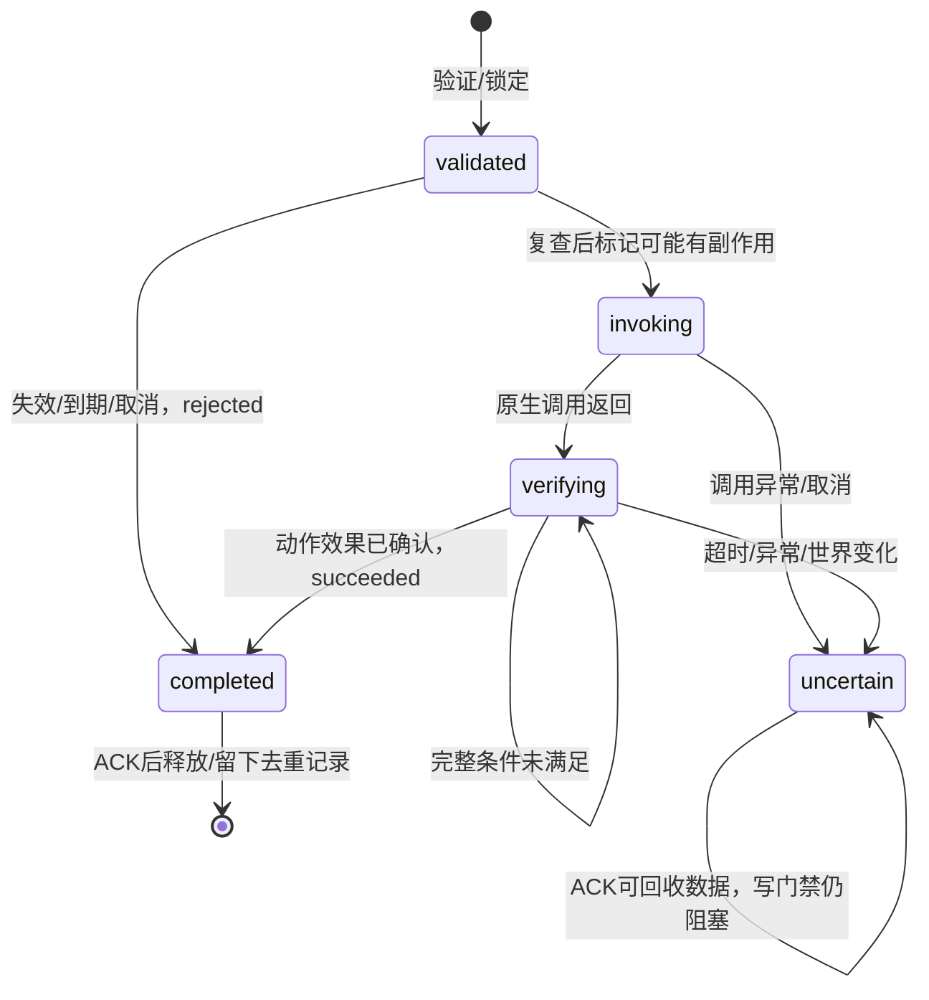

# PawnPilot M2-B 实现与验收

2026-10-31。**M2-B 整体 PASS**：wire v2、参数化契约、跨帧执行基础、持久化恢复及五工具 MCP 已交付；179 项自动化通过，真实 Codex 实机回归和授权清理完成。正式写能力仍只有 `close_menu`；本结论不表示买入、卖出或物品移动已开放。

## 基线与保留范围

开始 HEAD `6eadbf6`，工作区干净；M2-A 已提交，没有覆盖或重置其代码。读取 README、M1/M2-A 报告、Bridge/Protocol、broker/journal、MCP 及相关测试后，重新运行基线：**43 Python + 49 managed = 92 通过**。Python SDK stdio 测试在允许本机管道的宿主环境运行；不是把沙箱失败当成功。证据位于忽略的 `artifacts/m2b/baseline-*.log`。

Steam build 仍为 `26337366`，主程序集 SHA-256 仍为 `6398d44aa1675e1f02b63bc668868f970e0f5d3ae5a50f2aced8d06ca084e3b5`。应用版本门禁保持 `0.46D / VERSION 100-Rev6`，本轮 `PAWNPILOT_INIT` 日志也确认该版本。安装 ID/程序集路径及 `Codex → MCP stdio → loopback broker ← UnityWebRequest` 不变。

M2-A 诊断继续为显式 `-M2AProbe` 构建开关；不把顾客、报价或商品诊断投影提升为正式观察状态。原游戏 DLL 仅本机引用，不打包或修改。没有购买、出售、移动物品、任意方法或远程脚本 action。

## 协议与升级

精确字段、界限和状态规则统一在 [v2 契约](../protocol/v2-contract.md)；结构文件见 [wire-v2.json](../protocol/schemas/wire-v2.json)，跨语言样本见 [v2-close-menu.json](../protocol/fixtures/v2-close-menu.json)。fixture 显式标为测试输入，不代表真实游戏数据。JSON Schema 负责结构，代码还验证版本元组、期限关系、进度单调及动作后置条件。

保留既有 identity/lifecycle 的平面字段，新增 `interaction`、明确 `unsupported` 的 `business`、游戏侧 `legal_actions`。`business.item_refs=null` 表示未实现，不是“没有商品”。`ready` 仍只证明初始化；`interaction.consistency=unverified` 不伪造业务/UI 一致性。`operable` 只表示本阶段基础交互就绪，必须另看同次快照生成的具体动作；不能据此成交。

`act` 必须显式携带 `schema_version=2` 和严格 `arguments`。协议能描述受限 `customer_ref/item_refs/offer_ref/collection_fingerprint/option_ref`，但生产 `close_menu` 只接收 `{}`。集合顺序属于语义；重复项目、未知字段、显式 null、超长/超多参数和过深 JSON 均拒绝。同 ID 的全部参数参与 canonical fingerprint；新 ID 参数合法不等于动作已被授权或实现。

wire=2 与 journal format=2 独立。旧 Mod/wire1 请求明确拒绝；旧 MCP 的 v1 `act` 参数不会静默转为 v2。历史 v1 结果以 v2 查询 envelope 包裹，保留 `record_schema_version=1` 和原始证据内容。没有悄悄丢掉未知经济字段的兼容路线。

## 跨帧执行器

`Protocol.cs` 的 `ActionGate` 接口为 `Accept → Advance → Acknowledge`，另有本地 `Cancel` 和 broker epoch 变化处理。`Accept` 只验证、记录不可变请求及前置状态；`ProbeBehaviour.Update` 在主线程逐帧重新捕获状态并 `Advance`。原生 `EscapeUIManager.OnResume()` 仍是唯一正常写入口。网络协程独立交换快照、进度和结果，不等待动作完成。

内部执行阶段与外部命令终态不同。`running` 只证明 broker 已交付，不证明原生入口已调用。`may_have_side_effects` 在调用之前置 true；调用返回、UI 改变、业务完整确认分别处理。后置 verifier 可跨帧等待；未来规则须证明完整集合、条款、资金和库存一致，不能用固定两帧替代验证。

确认成功不等待后续必须由 Agent 推进的对话。动作完成与 `interaction.phase` 独立：场景仍可处于 `needs_agent` 或动画。成功结果 ACK 后可处理下一次决策；unknown ACK 后仍保持写锁。测试专用 verifier 注入不会由 wire/config 选择，也不注册新动作。

Mod 在 ACK 后回收 before/after/result 对象图，保留 ID、完整请求指纹、原终态及去重元数据。ACK 前重复交付返回原证据副本；ACK 后异常重交付只在本地拒绝，不重放、不发第二个冲突终态。broker 的持久化结果继续完整保留以供查询。第二个写命令不排队，也不会覆盖第一个命令的 ACK 所有权。

所有生产 Unity 访问均来自 MonoBehaviour 生命周期、`Update` 和 Unity coroutine；没有后台线程访问游戏对象。纯 `ActionGate` 依赖单线程调用约定，没有额外线程 ID 守卫。本地 `Cancel` 不是远程取消工具：调用前取消为已知拒绝，调用后取消为未知；退出时尚未确认的结果由 broker 断连恢复规则兜底。

`Runtime/ActionDriver.cs` 将 readiness 刷新、观察及逐帧推进包在同一异常边界。观察抛错会停止本会话执行器；调用前拒绝、调用后 unknown，不让持续观察异常绕过执行超时或产生迟到调用。broker epoch 取消依赖 Mod 已收到的新 epoch；网络尚未报告重启时，Mod 无法瞬时知道远端变化，broker 仍以交付级 unknown 保守处理，不宣称严格 exactly-once。

## 三类期限与 broker 状态

| 情况 | 处理 |
|---|---|
| pending 未交付，达到 start deadline | rejected；不会迟到交付 |
| 已交付，未获调用证据且开始期限已到 | outcome_unknown；不能假定没执行 |
| Mod 证明尚未调用即拒绝 | rejected；可解除 broker 的交付级 unknown，但不能覆盖已有调用证据 |
| invoking/verifying 超过执行期限或心跳断开 | outcome_unknown；不重放 |
| 原会话保留的有效结果迟到 | 按原 epoch/session 核验并持久化后 ACK |
| 已确认副作用完整、后续仍有交互 | succeeded；不等待下一次 Agent 决策 |
| broker 重启 | pending→rejected，running→unknown；已终态保留 |

`start_deadline_unix_ms` 为未开始有效期；`execution_timeout_ms` 在实际调用边界开始计时，Mod 用单调时钟，不受墙钟回拨延长；进度中的 started/deadline 关系不可变。`now >= deadline` 即过期。`heartbeat_timeout` 独立反映通信健康。进度会被采样，允许跳过中间阶段，但不允许倒退、同序号内容变化或调用后伪装为无副作用拒绝。

## journal 与人工恢复

沿用独占锁、临时文件 flush/fsync、原子替换及 4096 条/16 MiB 上限；容量不足明确失败，不淘汰去重记录。格式升级先严格验证 v1，保存同目录受控 `.v1.bak`，验证 format2 候选后原子替换。历史命令、指纹和证据不重新解释；迁移中断或失败保留原文件，已有匹配备份可幂等继续，冲突备份拒绝覆盖。

未知结果不能靠删除 journal 清除。人工对齐仍仅针对 `close_menu`，不暴露给 MCP；要求原 Mod 已退出、全新会话的当前状态可核对、最迟可能执行期限已过、版本已前进并提供人工说明。保留原 unknown 与独立 resolution，不伪造成交或动作成功。v1 尚未解决记录也保持阻塞；wire1 Mod 不允许继续提交旧结果。

同一 broker 进程还须等已知单调期限届满，墙钟前跳不能提前解除门禁。broker 重启后不能恢复原进程的单调计时起点，依靠持久化的最迟墙钟期限与人工确认旧 Mod 退出、新会话核对；会话字段本身不能证明旧进程已退出，操作者必须落实该前提。

## MCP 与等待

保留 `health_check/observe/act/get_action_status`，新增只读 `wait_for_update`。等待标准为 revision/身份变化、指定命令终态或基础可操作状态；最大 30 秒，使用单调截止时间，取消停止后续轮询。命令 unknown 虽是查询终态，仍阻塞新写动作。`not_found`、提交超时和断线均不允许换 ID 重试。

SDK 负责 stdio 协议；broker 不在线也可列出五个工具。Adapter 只投影游戏的合法动作，不复制经营规则。具体参数以 SDK 生成的 input schema 和 v2 契约为准。

Codex 示例把单工具超时设为 40 秒，以覆盖最长 30 秒等待及协议收尾，启用列表包含五工具；验证脚本仅使用临时 CLI 配置。配置字段依据本机 CLI 帮助及 [OpenAI 官方 MCP 文档](https://learn.chatgpt.com/docs/extend/mcp?surface=cli)核对。账户可用模型以真实客户端运行结果为准。

启动方式沿用 README：先运行 `.venv/Scripts/python.exe bridge/server.py --config artifacts/session.json`，再由 Codex 启动 `.venv/Scripts/python.exe -m pawnpilot_mcp`，cwd 为仓库。`PAWNPILOT_CONFIG` 可指定本机配置；Adapter 不代启 broker。五工具配置见 `docs/codex-config.example.toml`。`wait_for_update` 的 SDK 入参为 `request` 对象；调用者应以发现到的工具 Schema 为准。

## 测试记录与实机

基线 92 项重新运行通过。最终 **87 Python + 92 managed C# = 179 项通过，0 失败**，包含原有覆盖与新增测试。默认 Probe Release 构建 0 warning/0 error，M2-A 探针未开启。证据分别为 `artifacts/m2b/final-python.log`、`final-managed.log`、`final-probe-build.log`。随后将两个 MCP 模型用例的宽泛异常断言收紧为 `ValidationError`，对应两项再次通过；未修改生产代码。player Skill 校验通过。

中间失败：测试入口未捕获断言异常，Windows 显示 CLR 应用程序错误窗口；已增加顶层异常捕获和非零退出码，统一期限边界并重新测试。早期 restore 误用了全局 NuGet 路径和不可达代理，生成失败缓存；最终通过设置项目 `DOTNET_CLI_HOME/NUGET_PACKAGES`、用项目已有 NETStandard 引用包进行正常离线 restore 重建 assets，再实际编译通过。不把缓存修补或失败测试当作成功。

跨进程模拟已通过：MCP SDK stdio → Adapter → 临时端口 broker → 测试专用 C# `ModSimulator` → 生产 `ActionGate`。UI 在调用后 2 帧改变，测试效果验证在 24 帧后完成，其间多个 verifying 心跳持续到达；只调用一次，ACK 后进入 needs_agent，现金保持不变。测试 fixture 不加载 Unity、不注册生产测试 action。首跑发现重定向管道上的 `Console.In.ReadLineAsync()` 会同步阻塞，改为测试专用输入线程后通过；该线程不访问游戏对象。证据：`artifacts/m2b/managed-e2e.log` 与 `simulation/managed-events.jsonl`、`exchanges.json`。

真实 Codex CLI 离线验证 exit 0：实际调用 health_check、observe、get_action_status 和 wait_for_update；前三者返回结构化 connection 错误，有限等待返回 timed_out，没有提交 act。证据：`artifacts/m2b/codex/v2-disconnected-1.jsonl`。CLI 输出模型缓存字段/PowerShell snapshot 警告，但 MCP 调用及正常结束已由 JSONL 验证；这不算实机 close_menu 验收。

本轮另行申请并获得用户“批准上述完整范围”，覆盖 Computer Use、三个 Mod 文件安装、正常 network 启用、原存档备份、独立槽、一次真实 Codex `close_menu` 及清理；没有沿用 M2-A 授权。实际通过 Steam 启动正式游戏、正常 Mod 扫描，开发者模式关闭。默认 DLL SHA-256 为 `DD8A251D9C5D4AC2A20D370666F7B43A601387928BEBCCB58DDBAE946EAD0525`。日志确认 `running=True / trust=Match / caps=network`，并出现 BRIDGE_READY、CONNECTED。

### 已执行的本轮实机步骤与证据

1. 记录游戏进程/Mod 目录现状、原存档文件名与哈希，将原存档备份到项目忽略目录。保留游戏程序集哈希与安装收据。
2. 游戏退出时，仅向 `Mods/pawnpilot_m0` 安装本轮默认 Release DLL、manifest 和 session.json；启动本轮独立 broker。正常启用 Mod 和 network，不开开发模式。
3. 使用 Computer Use 操作 Steam 与 Probably Stolen 窗口，新建独立空白测试槽，不加载原进度。读取真实 wire v2 状态，正常打开 ESC 菜单。
4. 真实 Codex CLI 经五工具 MCP 提交一次 `close_menu`，以有限 wait 和原 ID 查询核对结果；比较现金、世界身份、菜单与执行证据。只验证已有非经济动作。
5. 游戏 UI 删除本次测试槽、禁用 Mod、正常退出；按收据清理本次安装的三个文件及空目录，停止本轮 broker，复核原存档及游戏程序集哈希。保留本机日志、截图及备份。

独立 `save_4` 测试槽从第 1 天、550 信用点开始。真实 Codex CLI（账户可用的非 Astra `gpt-5.6-luna`）exit 0，实际调用全部五个 MCP 工具；`act` 只有一次。命令 `codex-pawnpilot-20261031-8f2f5d9c-6b4a-4e1c-a7d3-91c0b2e6f845` 先返回 pending，有限等待及原 ID 查询均返回 succeeded / postcondition_observed。场景保持 InventoryScene、world/session 不变、ready=true；菜单 true→false，revision 3→4，现金 550→550，execution=completed、sequence=4。最终观察无执行进度/阻塞，游戏截图与 Mod 结果日志相符。没有买卖或移动物品。

真实客户端还额外执行一次只读 `Get-Content` 加载项目 player Skill；因此不宣称整个 CLI 会话只有 MCP 调用。游戏动作均经 MCP，没有额外 shell 游戏操作。CLI 的模型缓存/PowerShell snapshot 警告不影响实际工具结果。

实机证据位于 Git 忽略目录：`artifacts/m2b/codex/v2-live-close-menu-1.jsonl`、`live/codex-tool-results.json`、`live/Player-final.log`、`live/05-before-close-menu*`、`live/06-after-close-menu*`。截图 `07/08` 记录测试槽删除前后；删除后列表只剩原有第 7 天、394 信用点存档，该原槽没有被加载。`09-mod-disabled.png` 记录停用。游戏正常退出，按收据匹配哈希删除三个文件及空目录，停止本轮 broker；`live/cleanup-verification.json` 确认测试槽、Mod 目录、游戏进程及 18765 监听均不存在，原游戏程序集哈希不变。

实机前对存档目录 14 个根文件备份并记录哈希；清理后 3 个原进度文件（`save_0.es3` 及 day5/day6 历史文件）全部 SHA-256 相同。只读对比确认 `SaveFile.es3`、`saves_index.es3`、Player 两个日志变化，新增本次 GameLog；这些设置/索引及日志变化属于批准范围，未强行回滚。`mod-trust-list.json`、旧 GameLog 和 steam_autocloud.vdf 哈希相同。正常 Mod 启用/停用及 Steam/CLI 运行也会留下配置、信任或缓存记录，不宣称系统完全无痕。没有改全局 Codex 配置，备份、凭据、截图和原始日志保留在本机忽略目录。

## 验收表

| 项目 | 状态 | 证据与范围 |
|---|---|---|
| 协议 v2 | PASS | C#/broker/journal/MCP 共享契约、fixture 和严格验证 |
| 参数化动作 | PASS | 全参数验证及指纹；集合差异/重复 ID 测试 |
| 跨帧执行器 | PASS | 多帧 managed 测试及真实 C# gate 跨进程 E2E，等待中持续心跳 |
| 单写门禁 | PASS | 第二写拒绝，unknown 保持阻塞，ACK 所有权测试 |
| 效果边界 | PASS | 调用前后异常、UI/效果顺序、完整验证及后续交互分别测试 |
| 状态一致性 | PASS | ready 与 interaction 分离，真实业务明确 unsupported/unverified |
| 超时处理 | PASS | 三类期限、单调时钟、截止边界及调用前后不同结果 |
| 恢复与迁移 | PASS | v1 备份迁移、失败保护、损坏、容量和多次重启，不重放 unknown |
| MCP | PASS | 五工具 SDK 测试及真实 Codex 调用，有限等待/取消/错误分类 |
| 回归 | PASS | 基线 92 复核；最终 179 通过、0 失败 |
| 实机 | PASS | 本轮批准后一次 close_menu，现金不变，清理及原存档哈希核验 |
| 安全 | PASS | 正式 allowlist 仍仅 close_menu；密钥/游戏 DLL/存档/原始证据均不纳入 Git |

## M2-C/D 接入位置

M2-C 首先补齐 `Capture` 的可见顾客、前后柜集合、活动报价、UI/对话及阻挡；不能直接复制 M2-A 诊断。新增状态必须进入 world/revision 签名，引用与报价绑定完整集合。`interaction.consistency` 只能由动作特定的完整核对规则升级，未检查仍 unverified。

M2-D 通过同一 gate 的受限 dispatcher 与 verifier 接入动作；新增动作之前必须同时扩展明确 allowlist、参数规则、合法动作投影、成功证据及 journal 审查。资金/库存/归属联合验证、容量不足和不可逆副作用不能复用 close_menu 成功规则。任何调用后未知继续使用不可重放恢复语义，不增加万能 clear-unknown。

进入 M2-C 的基础条件已满足：本轮自动化及协议审查无未解决阻断，默认 Mod 完成获授权的原生 close_menu 回归。接下来须逐字段核实玩家可见的只读来源，建立完整集合、报价、UI 与 world/revision 的失效绑定并测试；未验证字段继续 unsupported/unverified。M2-C 不自动继承经济写操作授权。

没有已知未解决的严重阻断缺陷。保留限制：真实买入/卖出联合效果验证、单件操作、完整业务状态均未实现；普通业务 UI 的一致性不能由两个稳定帧推断。纯 gate 依赖主线程调用约定，远端 epoch 变化需通信送达；跨 broker 重启不能恢复旧单调时钟起点，人工恢复仍依赖操作者证明旧 Mod 已退出。不宣称严格 exactly-once 或能抵御人为删除 journal/磁盘损坏。

## 文件组织与独立复查

- C#：修改 `Protocol.cs`、`ProbeBehaviour.cs`，新增 `Runtime/ActionDriver.cs`、`Runtime/Observation.cs`；managed 工程/测试扩展及测试专用 `ModSimulator.cs`。
- Python：修改 `bridge/server.py`、`journal.py`、`client.py`，新增共享 `protocol.py` 与保存旧验证器的 `legacy_journal.py`；升级 `pawnpilot_mcp/server.py`。
- 契约与验证：新增 `protocol/v2-contract.md`、JSON Schema、共享 fixture；保留并适配既有 Python 测试，新增 broker/journal/protocol/MCP v2 和 managed E2E 测试。
- 使用说明：README、Codex 配置示例、真实客户端验证脚本、依赖清单/锁文件、player Skill 及本报告。

独立审查覆盖观察异常、调用/验证边界、结果不可变、ACK、超时、旧 journal、MCP 类型与取消。已修复：观察异常绕过执行推进；返回/回调对象可改写保留证据；unknown ACK 后重复发终态 progress；v1 unknown 查询访问 v2 字段；无结果的终态 progress 污染持久化；墙钟前跳提前人工对齐；MCP 数值类型被隐式转换及不完整成功证据；等待中 HTTP 调用超出绝对期限。修复后严格模型、成功证据共享验证和等待取消测试通过，独立复查未发现新的明确严重缺陷。

最终 Git：HEAD 仍为 `6eadbf6`；18 个 tracked 修改、14 个 untracked 新文件，全部未暂存；没有 commit/push。完整清单如下（原始产物不在清单内）：

| 类别 | 文件 |
|---|---|
| 修改：使用与配置 | `.agents/skills/pawnpilot-player/SKILL.md`、`README.md`、`docs/codex-config.example.toml`、`pyproject.toml`、`uv.lock`、`scripts/verify-codex.py` |
| 修改：生产代码 | `bridge/client.py`、`bridge/journal.py`、`bridge/server.py`、`pawnpilot_mcp/server.py`、`src/PawnPilot.Probe/Protocol.cs`、`src/PawnPilot.Probe/ProbeBehaviour.cs` |
| 修改：测试 | `tests/PawnPilot.CoreTests/PawnPilot.CoreTests.csproj`、`tests/PawnPilot.CoreTests/Program.cs`、`tests/test_bridge.py`、`tests/test_mcp.py`、`tests/test_process_recovery.py`、`tests/test_recovery.py` |
| 新增：生产代码 | `bridge/legacy_journal.py`、`bridge/protocol.py`、`src/PawnPilot.Probe/Runtime/ActionDriver.cs`、`src/PawnPilot.Probe/Runtime/Observation.cs` |
| 新增：契约与报告 | `protocol/v2-contract.md`、`protocol/schemas/wire-v2.json`、`protocol/fixtures/v2-close-menu.json`、`docs/m2b-implementation.md` |
| 新增：测试 | `tests/PawnPilot.CoreTests/ModSimulator.cs`、`tests/test_broker_v2.py`、`tests/test_journal_v2.py`、`tests/test_managed_e2e.py`、`tests/test_mcp_v2.py`、`tests/test_protocol_v2.py` |
